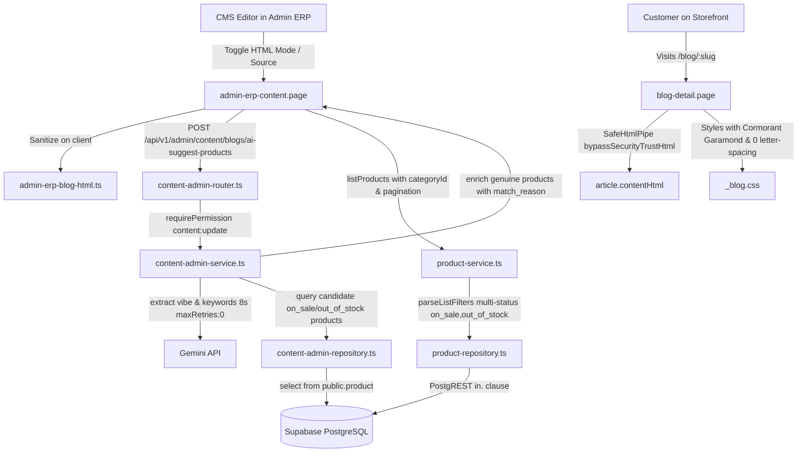

# Implementation Plan: Blog CMS HTML/Source Mode, AI Product Matching & Font Rendering Fix

**Feature ID**: `FEAT-BLOG-CMS-HTML-SOURCE-PRODUCT-MATCH`  
**Jira/Ticket**: `KAN-106`  
**Status**: APPROVED (Ready for Implementation)  

---

## 1. Architecture & Component Interaction



---

## 2. Implementation Phases & Detailed Technical Specifications

### Phase 1: Security & Sanitizer Allowlist Upgrade
1. **`apps/api/src/content/blog-html.ts`**:
   - Add `article`, `section`, `h1` to `ALLOWED_TAGS`.
   - Update `BLOCK_BOUNDARY` regex to include `article|section|h1`.
   - In `SANITIZE_OPTIONS`:
     - Add `allowedStyles` for `img`, `figure`, `figcaption`, `p`, `span`, `div`, `article`, `section`:
       - `display`: `/^(block|inline-block|flex|grid|none)$/`
       - `width`, `height`, `max-width`, `max-height`: `/^\d{1,4}(px|%|em|rem|vw|vh)$/`
       - `object-fit`: `/^(cover|contain|fill|none|scale-down)$/`
       - `border-radius`: `/^\d{1,3}(px|%|em|rem)$/`
       - `margin`, `margin-top`, `margin-right`, `margin-bottom`, `margin-left`: `/^(\d{1,3}(px|%|em|rem)\s*){1,4}$|^auto$/`
       - `padding`, `padding-top`, `padding-right`, `padding-bottom`, `padding-left`: `/^(\d{1,3}(px|%|em|rem)\s*){1,4}$|^auto$/`
       - `text-align`: `/^(left|right|center|justify)$/`
     - Add `allowedAttributes`:
       - `img`: `["src", "alt", "title", "width", "height", "loading", "style", "class"]`
       - `figure`, `figcaption`, `article`, `section`, `p`, `span`, `div`, `h1`, `h2`, `h3`, `h4`: `["class", "style"]`
       - `a`: `["href", "title", "target", "rel", "class"]`
2. **`apps/admin-erp-ng/src/app/core/admin-erp-blog-html.ts`**:
   - Add `article`, `section`, `h1` to `ALLOWED_TAGS`.
   - Update `BLOCK_SELECTOR` to include `article,section,h1`.
   - Update `cleanNode()`:
     - Allow safe attributes on all allowed tags: `class`, `style`.
     - On `img`, allow `width` with percentage or integer (`/^\d{1,4}%?$/`).
     - Parse inline `style` attribute into declarations. Validate property against allowed list (`display`, `width`, `height`, `max-width`, `max-height`, `object-fit`, `border-radius`, `margin`, `margin-top`, `margin-bottom`, `margin-left`, `margin-right`, `padding`, `padding-top`, `padding-bottom`, `padding-left`, `padding-right`, `text-align`).
     - Strictly discard any declaration containing `(`, `)`, `"`, `'`, `/`, `\\`, `@`, or `var`.
3. **`apps/user-ng/src/app/shared/pipes/safe-html.pipe.ts`**:
   - Create standalone `SafeHtmlPipe` implementing `PipeTransform`:
     ```typescript
     @Pipe({ name: 'safeHtml', standalone: true })
     export class SafeHtmlPipe implements PipeTransform {
       private readonly sanitizer = inject(DomSanitizer);
       transform(value: string | null | undefined): SafeHtml {
         return this.sanitizer.bypassSecurityTrustHtml(value || '');
       }
     }
     ```
4. **`apps/user-ng/src/app/features/content/blog-detail.page.ts` & `.html`**:
   - Import `SafeHtmlPipe` into `BlogDetailPage.imports: [RouterLink, SafeHtmlPipe]`.
   - Update line 35 of `blog-detail.page.html`: `<div class="article-rich" [innerHTML]="article.contentHtml | safeHtml"></div>`.

---

### Phase 2: Vietnamese Typography & Kerning Fix
1. **`apps/user-ng/src/styles-velura/pages/_blog.css`**:
   - Replace all occurrences of `"Playfair Display", Georgia, serif` with `var(--velura-font-display, "Cormorant Garamond", Georgia, serif)`.
   - Replace all occurrences of `"DM Sans", sans-serif` with `var(--velura-font-ui, "Inter", sans-serif)`.
   - On `.article-header__title` (lines 615, 1721, 1884): reset `letter-spacing: -.035em;` to `letter-spacing: 0;` (or `-0.015em;`).
2. **`apps/api/src/content/content-admin-service.ts`**:
   - In helper `draft(body: JsonObject)`: enforce Unicode NFC normalization:
     ```typescript
     const title = asString(body.title).normalize('NFC').trim();
     const excerpt = asString(body.excerpt).normalize('NFC').trim();
     const content = asString(body.content).normalize('NFC').trim();
     const contentHtml = sanitizeBlogHtml(body.contentHtml).normalize('NFC');
     ```

---

### Phase 3: Backend Multi-Status Query & AI Product Suggestion
1. **`apps/api/src/products/product-service.ts` & `product-repository.ts`**:
   - In `parseListFilters`:
     ```typescript
     const rawStatus = searchParams.get("status");
     if (rawStatus) {
       const tokens = rawStatus.split(",").map((s) => s.trim()).filter(Boolean);
       for (const token of tokens) {
         if (!PRODUCT_STATUSES.includes(token as (typeof PRODUCT_STATUSES)[number])) {
           throw validationError("status", "Bộ lọc trạng thái không hợp lệ");
         }
       }
     }
     ```
   - In `product-repository.ts`: if `filters.status` contains comma, pass `in.(${tokens.join(",")})` to PostgREST.
2. **`apps/api/src/content/content-admin-repository.ts`**:
   - Define and export interface:
     ```typescript
     export interface BlogProductCandidate {
       product_id: string;
       name: string;
       slug: string;
       base_price: number;
       sale_price: number | null;
       images: string[];
       status: string;
       category_id?: string;
       description?: string;
     }
     ```
   - Add method to `ContentAdminRepository`:
     ```typescript
     listCandidateProducts(
       options: { limit?: number },
       accessToken: string | null
     ): Promise<BlogProductCandidate[]>;
     ```
   - Implement in `createContentAdminRepository`: query `product` table with `status=in.(on_sale,out_of_stock)&limit=${options.limit || 30}&order=updated_at.desc`.
3. **`apps/api/src/content/content-admin-service.ts`**:
   - Export DTO interface:
     ```typescript
     export interface BlogProductCandidateMatch extends BlogProductCandidate {
       match_reason: string;
     }
     export interface BlogProductSuggestionResult {
       suggestedProducts: BlogProductCandidateMatch[];
       reasoning: string;
     }
     ```
   - Implement `suggestBlogProducts(context: AuthContext | undefined, body: JsonObject)`:
     1. Verify `requirePermission(context, "content", "update")`.
     2. Extract plain text: `const plainText = blogPlainText(sanitizeBlogHtml(body.contentHtml)).slice(0, 3000)`.
     3. Fetch candidate products from repository: `await repository.listCandidateProducts({ limit: 40 }, context?.accessToken || null)`.
     4. Call Gemini with timeout 8000ms and `maxRetries: 0`:
        - Prompt: `"Phân tích bài viết thời trang sau và xác định phong cách, chủng loại trang phục phù hợp: ..."`
        - Schema: `{ type: "object", properties: { keywords: { type: "array", items: { type: "string" } }, styleVibe: { type: "string" }, reasoning: { type: "string" } }, required: ["keywords", "styleVibe", "reasoning"] }`.
     5. Token scoring / Grounding: Rank candidate products by overlap between product `name` / `description` and Gemini `keywords`/`styleVibe`. Top candidates are returned with `match_reason: "Thiết kế ${p.name} chuẩn phong cách ${vibe}, phù hợp hoàn hảo với bài viết."`.
     6. Fallback `fallbackBlogProductSuggestions`: if Gemini times out or is unconfigured, match words from `title` and `plainText` against candidate names, returning top 6 with a graceful fallback reasoning string.
4. **`apps/api/src/content/content-admin-router.ts`**:
   - Add route handler for `POST /api/v1/admin/content/blogs/ai-suggest-products`:
     ```typescript
     if (parts[4] === "blogs" && parts[5] === "ai-suggest-products" && req.method === "POST") {
       const body = asJsonObject(await readJson(req));
       const result = await service.suggestBlogProducts(context, body);
       return sendJson(res, 200, result, headers);
     }
     ```

---

### Phase 4: Admin ERP Blog Editor - HTML Source Mode & Product Tab Enhancements
1. **`apps/admin-erp-ng/src/app/core/admin-erp-api.service.ts`**:
   - Export interfaces:
     ```typescript
     export interface AdminBlogProductMatch extends AdminBlogProduct {
       match_reason: string;
     }
     export interface AdminBlogProductSuggestionPayload {
       suggestedProducts: AdminBlogProductMatch[];
       reasoning: string;
     }
     ```
   - Add method to `AdminErpApiService`:
     ```typescript
     suggestBlogProducts(payload: { title: string; excerpt?: string; contentHtml: string; limit?: number }): Observable<AdminBlogProductSuggestionPayload> {
       return this.http.post<AdminBlogProductSuggestionPayload>(`${this.baseUrl}/api/v1/admin/content/blogs/ai-suggest-products`, payload);
     }
     ```
2. **`apps/admin-erp-ng/src/app/features/content/admin-erp-content.page.ts` & `.html`**:
   - **HTML Source Mode**:
     - Signal: `sourceMode = signal<boolean>(false)`.
     - In toolbar: button `toggleSourceMode()` with label `{{ sourceMode() ? 'Trình soạn trực quan' : 'Mã HTML / Source' }}`.
     - In HTML: `#editor` has `[hidden]="sourceMode()"`. Textarea has `[hidden]="!sourceMode()"`. Both remain in DOM to avoid race conditions:
       ```html
       <div #editor class="content-editor__surface" [hidden]="sourceMode()" ...></div>
       <textarea class="content-editor__source" [hidden]="!sourceMode()" [value]="draft()?.contentHtml || ''" (input)="onSourceInput($event)" placeholder="Nhập hoặc dán mã nguồn HTML..."></textarea>
       ```
     - `toggleSourceMode()`:
       - If switching from Source to WYSIWYG: `#editor.innerHTML = sanitizeEditorHtml(this.draft()?.contentHtml || '')`.
       - Toggle `this.sourceMode.update((v) => !v)`.
     - In `save()`:
       ```typescript
       const contentHtml = this.sourceMode()
         ? (draft.contentHtml || '')
         : (this.editor()?.nativeElement?.innerHTML ?? draft.contentHtml);
       ```
     - Disable/hide WYSIWYG formatting buttons in toolbar when `sourceMode() === true`.
     - In `resetEditorState()`: reset `this.sourceMode.set(false)`.
   - **Product Tab Improvements**:
     - Signals:
       - `productCategories = signal<AdminCategoryRow[]>([])`
       - `productCategoryId = signal<string>('')`
       - `productPage = signal<number>(0)`
       - `productPageSize = 8`
       - `productTotal = signal<number>(0)`
       - `productTotalPages = computed(() => Math.max(1, Math.ceil(this.productTotal() / 8)))`
       - `aiProductLoading = signal<boolean>(false)`
       - `aiProductError = signal<string | null>(null)`
       - `suggestedProducts = signal<AdminBlogProductMatch[]>([])`
     - Unified `fetchProducts()` method: calls `this.api.listProducts({ q, categoryId, status: 'on_sale,out_of_stock', limit: '8', offset: String(this.productPage() * 8), order: 'updated_at.desc' })`.
     - `onProductCategoryChange(event)`: update `productCategoryId`, reset `productPage.set(0)`, call `fetchProducts()`.
     - `onProductPageChange(delta)`: update `productPage`, call `fetchProducts()`.
     - In template: render category dropdown `<select [value]="productCategoryId()" (change)="onProductCategoryChange($event)">`.
     - Render pagination bar: `[Trước]` `Trang {{ productTotal() ? (productPage() + 1) : 0 }} / {{ productTotal() ? productTotalPages() : 0 }} ({{ productTotal() }} sản phẩm)` `[Sau]`.
     - **AI Product Suggestion**:
       - Button `AI Gợi ý Sản phẩm Phù Hợp` in product search toolbar.
       - Calling `this.api.suggestBlogProducts(...)` with current draft title & content.
       - On success: sets `suggestedProducts`.
       - Renders suggested section with `match_reason` badge and buttons: `Đính kèm tất cả gợi ý` or `Đính kèm` per item.

---

## 3. Verification & Acceptance Testing Suite

1. **Unit & Integration Tests**:
   - `apps/admin-erp-ng/src/app/core/admin-erp-blog-html.spec.ts`: test `<article>`, `<h1>`, `<figure>`, `` with `style`, `width="100%"`, `figcaption`.
   - `tests/api/content-admin.test.ts`: verify `POST /api/v1/admin/content/blogs/ai-suggest-products` returns authentic products and match reasons.
   - `tests/api/product-filter.test.ts` (or existing product tests): test multi-status parsing `on_sale,out_of_stock`.
2. **Typecheck & Build**:
   - `npm run typecheck:api`
   - `npm run build:api`
   - `npm run build:admin-erp`
   - `npm run build:user`
