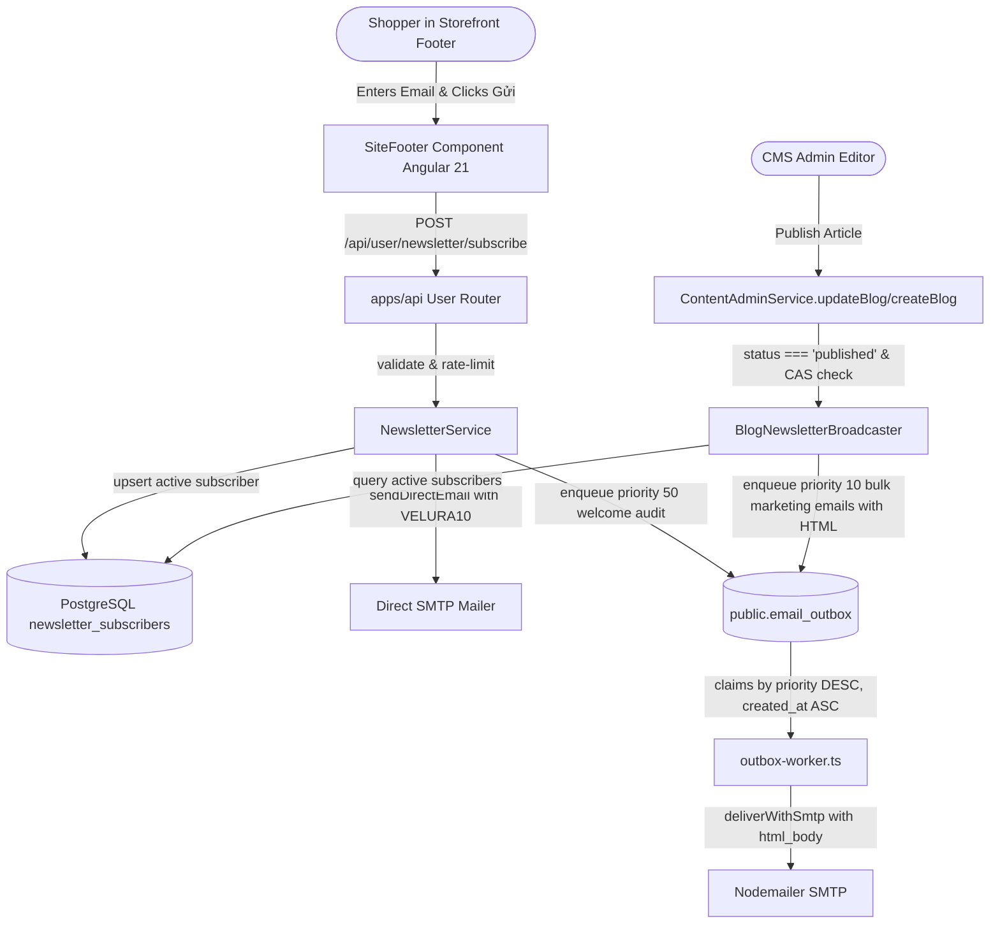

# Implementation Plan: Newsletter Subscription & Automated Blog Broadcast System

**Feature ID**: `FEAT-NEWSLETTER-BLOG-BROADCAST`  
**Jira/Ticket**: `KAN-67`  
**Status**: APPROVED (Ready for Implementation)

---

## 1. Architecture & Component Structure

---

## 2. Implementation Steps

### Phase 1: Database Schema & Migration
- Create `database/migrations/108_feat_newsletter_blog_broadcast.sql`:
  - `newsletter_subscribers` table with unique lowercase index and RLS.
  - Add `priority` and `html_body` columns to `public.email_outbox`.
  - Update `velura_claim_email_outbox` RPC to order by `priority DESC, created_at ASC`.
  - Add `newsletter_broadcast_at` to `public.blog`.
  - Seed `VELURA10` in `public.voucher`.

### Phase 2: Email Engine HTML & Priority Support
- Update `apps/api/src/email/outbox-worker.ts`:
  - Pass `html_body` to Nodemailer in `deliverWithSmtp`.
  - Include RFC 8058 `List-Unsubscribe` headers.

### Phase 3: Backend Newsletter Service & Router
- Create `apps/api/src/newsletter/newsletter-service.ts`:
  - `subscribe(email, source, honeypot)`: validation, rate limiting, subscriber persistence, welcome HTML email generation, direct SMTP dispatch.
  - `unsubscribe(token)`: token lookup, set `status = 'unsubscribed'`, return confirmation.
  - `broadcastBlog(blogId, slug, title, excerpt, imageUrl)`: query active subscribers, format high-fashion HTML newsletter, enqueue bulk rows in `email_outbox` with priority 10.
- Create `apps/api/src/newsletter/newsletter-router.ts`:
  - Handle `POST /api/user/newsletter/subscribe` and `GET /api/user/newsletter/unsubscribe`.
- Mount in `apps/api/src/user/index.ts`.

### Phase 4: CMS Blog Publication Hook
- Hook into `apps/api/src/content/content-admin-service.ts`:
  - On `createBlog` and `updateBlog`, detect transition to `status === 'published'`.
  - If `newsletter_broadcast_at` is null, trigger asynchronous `broadcastBlog` and stamp `newsletter_broadcast_at = now()`.

### Phase 5: Storefront Footer Integration (Angular 21)
- Update `apps/user-ng/src/app/layout/site-footer/site-footer.ts`:
  - Add signals: `email`, `submitting`, `statusMessage`, `errorMessage`.
  - Inject HttpClient / ApiService.
  - Implement `submitNewsletter()` method.
- Update `apps/user-ng/src/app/layout/site-footer/site-footer.html`:
  - Bind input `[value]="email()" (input)="onEmailInput($event)"`.
  - Add submit button loading state `[disabled]="submitting()"`.
  - Add accessible status feedback container with `aria-live="polite"`.

### Phase 6: Automated Verification & Testing
- Unit tests:
  - `site-footer.spec.ts`: Test form signals, validation, error/success messages.
  - `newsletter-service.test.ts`: Test subscriber registration, idempotency, voucher email formatting, unsubscribe token validation.
- End-to-end typecheck and build validation across all 4 apps.
